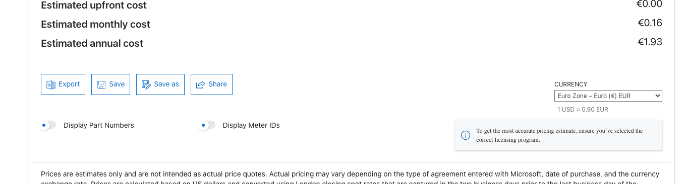

# Cost estimate: S2C Azure landing + Airflow

**Status: Approved 2026-11-27** | Region: Switzerland North (same as Snowflake: AZURE_SWITZERLANDN) | Currency: EUR
Source: Azure Pricing Calculator, 2026-11-27 ([Excel export](cost/azure_pricing_estimate.xlsx))

## Volume
- About 53 files, about 5 MB in total (initial load + 12 waves + 2 test waves)
- About 30 DAG runs per month during the project

## Estimate per month
| Service | Calculator (upper bound) | Realistic | Note |
|---------|-------------------------:|----------:|------|
| Storage (ADLS Gen2, Standard, LRS, Hot, 1 GB) | 0.16 | 0.16 | Hierarchical namespace on |
| ADF activity runs | 0.90 | 0.03 | Calculator minimum unit is 1,000 runs; real use about 30 |
| ADF copy (data integration unit hours) | 0.22 | 0.22 | 1 DIU-hour safe upper bound |
| ADF operations (read/write, monitoring) | 0.00 | < 0.01 | A few hundred per month vs a 50,000 unit |
| Event Grid | 0.00 | 0.00 | Within free monthly allowance |
| Key Vault | 0.00 | 0.00 | About 1,000 operations |
| Airflow | 0.00 | 0.00 | Local Docker on the Mac |
| **Total** | **about 1.28** | **about 0.41** | Target: under 1 (realistic) |

Data Flow, SSIS, Managed VNET and self-hosted runtimes: not used (0).

## Cost controls
- Budget EUR 1 with alerts at 50%, 100%, forecast 100%; anomaly alerts on
- Azure Policy: Switzerland North only, approved resource types, Standard_LRS only
- Lifecycle rule deletes landing files after 7 days
- ADF has no triggers; runs only when Airflow calls it
- Teardown: `az group delete -n rg-s2c-dev`

## Not counted
- Snowflake credits (separate account, resource monitor + auto-suspend)
- Data transfer: none between clouds (Snowflake and ADLS both in Azure Switzerland North)

## Screenshots
**Storage account estimate (per month):**

**Total estimate in EUR:**

