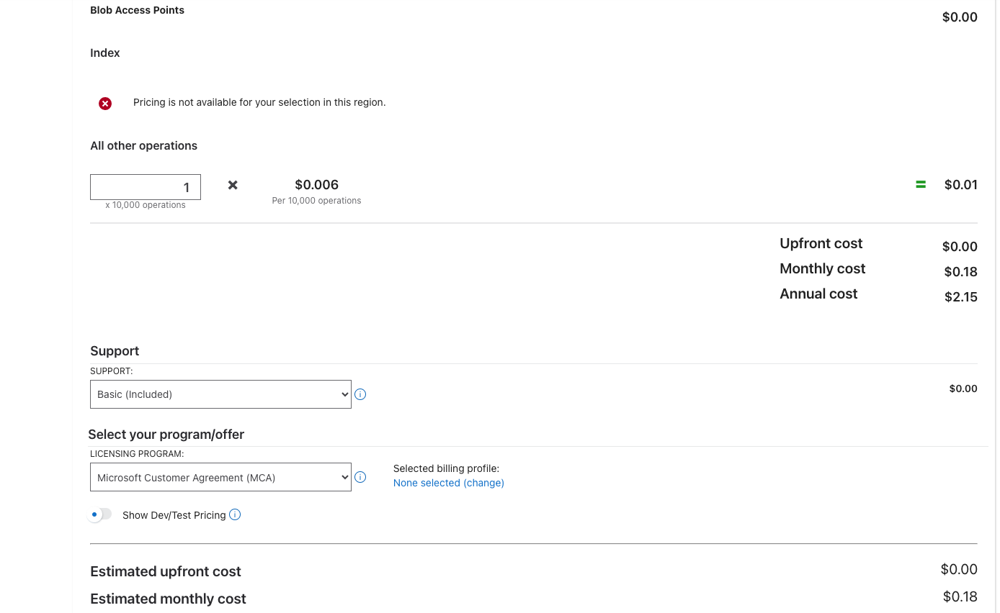

# Cost estimate: S2C Azure landing + Airflow

**Status: Approved 2026-11-27** | Region: Switzerland North (same as Snowflake: AZURE_SWITZERLANDN) | Currency: EUR
Source: Azure Pricing Calculator, 2026-11-26 ([Excel export](cost/azure_pricing_estimate.xlsx))

## Calculator result (upper bound)
| Service | Configuration | Monthly | Annual |
|---------|---------------|--------:|-------:|
| Storage account | ADLS Gen2 (hierarchical namespace), Standard, LRS, Hot, 1 GB | 0.16 | 1.93 |
| Azure Data Factory | V2, Data Pipeline, Azure IR, 1,000 activity runs | 0.90 | 10.77 |
| **Total** | | **1.06** | **12.70** |

Storage detail (monthly): capacity 0.02, write ops 0.06, read ops 0.01, iterative read 0.01, iterative write 0.06, other ops 0.01.
Not used (0): Data Flow, SSIS, Managed VNET runtime, self-hosted runtime, SFTP, blob access points.

## Realistic monthly cost
| Item | Why it differs | Monthly |
|------|----------------|--------:|
| Storage | Same as calculator | 0.16 |
| ADF activity runs | Calculator minimum is 1,000 runs; real use about 30 (30/1,000 x 0.90) | 0.03 |
| ADF copy time | About 1 data-integration-unit hour at 0.22 | 0.22 |
| ADF operations, Event Grid, Key Vault | Within free allowances / a few hundred operations | 0.00 |
| Airflow | Local Docker on the Mac | 0.00 |
| **Total** | | **about 0.41** |

Charter target: under EUR 1 per month (realistic) - met.

## Cost controls
- Budget EUR 1 with alerts at 50%, 100%, forecast 100%; anomaly alerts on
- Azure Policy: Switzerland North only, approved resource types, Standard_LRS only
- Lifecycle rule deletes landing files after 7 days
- ADF has no triggers; runs only when Airflow calls it
- Teardown: `az group delete -n rg-s2c-dev`

## Not counted
- Snowflake credits (separate account, resource monitor + auto-suspend)
- Data transfer between clouds: none (Snowflake and ADLS both in Azure Switzerland North)

## Evidence
**Storage account estimate:**

