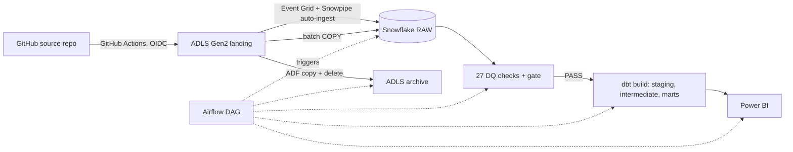

# Design: S2C Azure landing + Airflow orchestration

Status: Draft v1, 2026-11-27 | Owner: Diponkar Sinha | Related: [charter](project_charter.md), [requirements](requirements.md), [cost](cost_estimate.md)

## 1. Target architecture

Only the landing layer changes. RAW, checks, dbt and marts stay as in v1.0.

## 2. Components
| Component | Role | Name |
|-----------|------|------|
| Resource group | Holds all Azure parts | rg-s2c-dev |
| Storage account (ADLS Gen2, LRS) | Landing, archive, quarantine | sts2cdev |
| Event Grid + storage queue | Tells Snowpipe a stream file arrived | snowpipe-stream |
| Data Factory | Moves loaded files landing -> archive | adf-s2c-dev |
| Key Vault | Secrets for Airflow | kv-s2c-dev |
| Snowflake | Storage + notification integrations, external stages | S2C_AZ_STORAGE, S2C_AZ_NOTIFY |
| Airflow (local Docker) | Single orchestrator | DAG s2c_daily |

Region: Switzerland North for everything (same as Snowflake AZURE_SWITZERLANDN: no cross-cloud transfer).
Tags on every resource: project=s2c, env=dev, owner=diponkar.

## 3. Lake layout
- landing/batch/<source>/<entity>/<yyyy>/<mm>/<dd>/<commit>/<file>
- landing/stream/risk_events/<yyyy>/<mm>/<dd>/<file>
- archive/ same structure (kept, cool tier later)
- quarantine/ files that fail blocking checks
- Lifecycle: delete landing files after 7 days

## 4. Data contracts
| Source | Entity | Format | Path | Arrives |
|--------|--------|--------|------|---------|
| SAP | PO items, cost centres | CSV ; | landing/batch/sap/... | daily batch |
| SAP | Suppliers, FX rates | XML | landing/batch/sap/... | daily batch |
| SAP | Invoices | Parquet | landing/batch/sap/... | daily batch |
| Ariba | Contracts, sourcing events | JSON | landing/batch/ariba/... | daily batch |
| Ariba | Approvals, categories | CSV , | landing/batch/ariba/... | daily batch |
| Finance | Savings tracker | Excel -> CSV (converted by uploader) | landing/batch/finance/... | weekly |
| Risk provider | Risk events | NDJSON | landing/stream/risk_events/... | continuous |
Breaking a contract (schema drift, empty file, duplicate) is caught by the 27 checks and tested by the waves.

## 5. Security and access matrix
| Identity | How it logs in | Can do | Scope |
|----------|----------------|--------|-------|
| GitHub Actions (s2c-github) | OIDC federated credential, no secret | Storage Blob Data Contributor | landing container |
| Snowflake storage integration | Azure consent (multi-tenant app) | Storage Blob Data Reader | storage account |
| Snowflake notification integration | Azure consent | Storage Queue Data Contributor | storage account |
| ADF | System-assigned managed identity | Storage Blob Data Contributor | storage account |
| Airflow (s2c-airflow) | Service principal, secret in Key Vault | Data Factory Contributor | adf-s2c-dev |
| Airflow -> Snowflake | Key-pair (private key in Key Vault) | S2C_LOADER role | S2C_AZ / S2C_DEV |
No passwords or keys in code; .env, *.p8, *.pem git-ignored.

## 6. Orchestration standard
- Airflow is the only scheduler; ADF has no triggers; overlapping Snowflake tasks suspended
- DAG: wait_for_new_files -> load_batch -> run_checks -> check_gate -> dbt_build -> archive_files -> refresh_power_bi
- Every task: retries=2, retry_delay=5 min, execution_timeout, email on failure; max_active_runs=1, catchup off
- Every step safe to re-run (COPY skips loaded files, dbt idempotent, archive uses a watermark)
- Stream path stays event-driven: Event Grid + Snowpipe + stream task (not scheduled by Airflow)

## 7. Environments
- S2C_AZ: temporary test database (built with run_sql.py --db S2C_AZ)
- S2C_DEV: main database; switched to Azure only after tests pass
- Later (v2.4): S2C_PROD with promotion

## 8. Rollback
- Git tag v1.0-snowflake-only in source + dbt repos
- Uploader flag LANDING=snowflake|azure (default snowflake until cutover)
- Stages keep the same names; switching back = re-run v1.0 versions of 02 and 06
- Target: rollback within 30 minutes

## 9. Cutover
1. All 12 + 2 waves pass in S2C_AZ, totals equal baseline_v1
2. Apply integrations, external stages, auto-ingest pipe to S2C_DEV
3. Disable old ingest.yml; suspend overlapping tasks
4. Smoke test one file on S2C_DEV, gate PASS
5. Drop S2C_AZ; merge azure-landing; tag v2.0-azure-airflow

## 10. Key decisions
| Decision | Chosen | Alternative | Why |
|----------|--------|-------------|-----|
| Landing | ADLS Gen2 | Snowflake internal stage | Replay, archive, decoupling, real-world pattern |
| Region | Switzerland North | West Europe | Same as Snowflake: no egress, lower latency |
| Orchestrator | Airflow | ADF only / Snowflake tasks | Coordinates Azure + Snowflake + dbt + Power BI in code |
| ADF role | Archive copy only | Full orchestration | One scheduler; ADF is best at data movement |
| Redundancy | LRS | GRS | Dev project, cheapest; noted for prod |
| Auth | OIDC + managed identity + Key Vault | Keys / SAS tokens | No stored secrets |

## 11. Scale notes (not built, by design)
For GB-TB daily volumes: partition folders by date (already), larger/multi-cluster warehouse for COPY, Snowpipe for batch too, incremental dbt models (already), ADF parallel copies, archive to cool/archive tiers.
